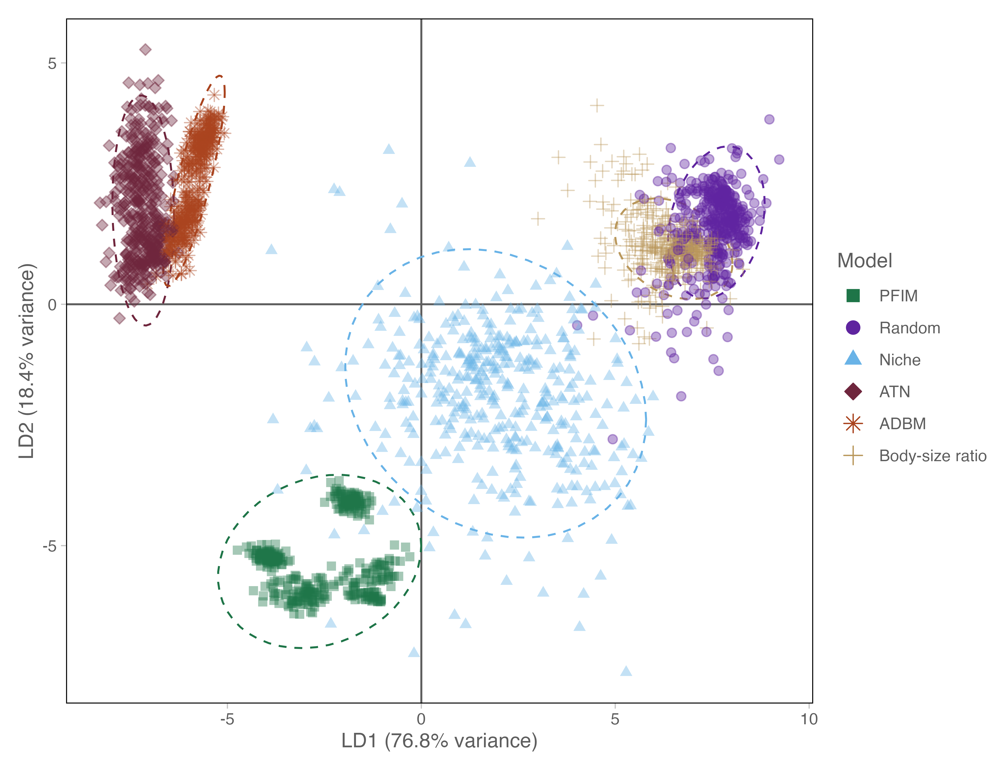

# Introduction

Understanding how biological communities are organised and how species interact with each other is a central goal of ecology. While early efforts focused primarily on species richness and composition, there is growing recognition that ecological communities are structured not only by which species occur, but by how they interact [@thuiller2024; @mestre2026; @gravel2019]. Interaction networks are increasingly treated as macroecological state variables where they are used to compare community organisation across environmental gradients [@tylianakis2017], quantify $\beta$-diversity in interaction structure [@trøjelsgaard2016; @poisot2015], evaluate stability–complexity relationships [@allesina2012], and infer vulnerability under global change [@hao2025].

As a result, ecological networks now play a central role in comparative analyses spanning latitudinal gradients, disturbance regimes, and deep time environmental transitions [@hao2025; @michalska-smith2019; @dunhill2024; @roopnarine2006; @poisot2014]. Implicit in this expansion is the critical assumption that network properties estimated across systems using various models are structurally comparable, and that differences among network properties reflect ecological signal rather than methodological artefact [@jordano2016; @fründ2016]. However, most ecological networks are not fully observed as interaction data are incomplete and sampling is uneven across historical and biogeographic contexts, across both present day and deep time [@sandra2025; @poisot2021].

Interactions must often be inferred indirectly from traits (*e.g.,* body size), phylogeny, co-occurrence, or theoretical constraints [@strydom2021; @morales-castilla2015]. Network construction therefore constitutes a model-based inference step rather than a purely observational exercise. Different reconstruction frameworks encode distinct ecological assumptions about how interactions arise - whether as biologically feasible combinations of traits, energetically optimised realised diets, or topological structures. These assumptions act as structural priors over network architecture [@strydom2026; @gauzens2025; @petchey2011; @guimarães2020] and begs the question if alternative reconstruction approaches systematically generate different trophic configurations. Risking conflating ecological differences among communities with artefacts introduced by reconstruction choice. The reliability of macroecological inference therefore depends not only on ecological data, but on the structural assumptions embedded in network reconstruction approaches.

Despite rapid methodological development in interaction inference, few studies have directly evaluated how alternative approaches to constructing networks influence macroecological conclusions when applied to the same species pool. This gap is particularly consequential for comparative research, where network metrics are routinely interpreted as indicators of environmental filtering, disturbance intensity, evolutionary history, or community stability [@delmas2018; @allesina2012; @poisot2015] and begs the question if reconstruction approaches encode distinct structural constraints over interaction topology, then differences among communities may reflect reconstruction assumptions rather than ecological processes.

Deep time ecosystems provide an especially useful test of this issue because trophic interactions are not observed directly and must be inferred from traits, co-occurrence, and theoretical constraints [@dunne2008; @dunne2014; @dunhill2024; @roopnarine2006; @smith2025]. As a result, ecological networks in these systems are inherently reconstruction-dependent, rendering the assumptions embedded within different reconstruction frameworks both explicit and consequential. Among such systems, the Early Toarcian Extinction Event (ETEE; \~183 Ma) provides a particularly informative case study. The ETEE was a major Early Jurassic biotic crisis associated with rapid climatic warming, widespread marine oxygen depletion, and substantial ecological turnover [@kemp2024]. Although considered a second-order extinction event globally, it nevertheless resulted in the loss of approximately 26% of marine genera worldwide [@little1995]. Ecological disruption was especially severe in shallow marine ecosystems, where environmental stress drove extensive restructuring of benthic communities and food webs. In the Cleveland Basin of Yorkshire, the ETEE caused the extinction of around 60% of marine species, including up to 87% of benthic taxa [@caswell2009]. Fossil assemblages from this interval therefore record both the collapse of established communities and the subsequent recovery and reassembly of marine ecosystems under rapidly changing environmental conditions. Recent work has shown that the event selectively impacted specialist and infaunal organisms, leading to simplified ecosystems increasingly dominated by ecological generalists and opportunistic taxa [@dunhill2024]. These changes were accompanied by major shifts in community structure, trophic interactions, and ecosystem connectivity, with evidence suggesting that ecological recovery following the extinction was both prolonged and uneven across marine habitats.

Ecological networks have previously been used to infer patterns of community organisation and extinction dynamics across this transition, providing an ideal test case for evaluating the robustness of network-based inferences of community response. Recent work by @dunhill2024 has used reconstructed food webs to draw ecological conclusions about community stability and collapse during this event. This creates a rare opportunity to ask a more general question - to what extent are such inferences contingent on the specific reconstruction framework used to generate the network?

Here, we reconstruct ecological networks for four successive assemblages across the ETEE using six contrasting reconstruction frameworks spanning feasibility-based, realised, and structural models. Holding species composition constant while varying only the reconstruction approach allows us to explicitly evaluate whether conclusions drawn from a single reconstruction approach (such as those of @dunhill2024) are robust to alternative, equally plausible representations of interaction structure, or whether different reconstruction choices would lead to fundamentally different ecological inferences. More broadly, our study tests whether macroecological conclusions derived from ecological networks reflect underlying biological processes or are conditioned by the assumptions embedded within the reconstruction framework itself.

# Methods

## Study system and fossil data

We used fossil occurrence data from the Cleveland Basin, UK, spanning the late Pliensbachian to the late Toarcian. This interval encompasses a major volcanic-driven hyperthermal and marine extinction event. To capture network dynamics across this transition, we defined four successive palaeo-assemblages: pre-extinction (Pliensbachian), post-extinction (early Toarcian), early recovery (early–middle Toarcian) and late recovery (late Toarcian). Each taxon was characterised using their size and Bambach’s ecospace framework [@bambach2007], coding for tiering, motility, and feeding mode as per @dunhill2024. Each assemblage was treated as a community of potentially interacting taxa. The dataset includes 57 taxa across diverse groups (*e.g.,* cephalopods, bivalves, and gastropods). See @dunhill2024 for detailed descriptions of the dataset, including taxonomic composition, trait coding, and temporal resolution.

## Network reconstruction approaches

### Conceptual classification of network types

Ecological network reconstruction encompasses a range of approaches that differ in how trophic interactions are inferred and in the ecological assumptions they encode. These approaches can be broadly grouped into three classes: feasibility-based, realised, and structural models. Together, these classes represent distinct hypotheses about how interactions arise and constrain the space of possible food web structure [@strydom2026].

Feasibility-based models infer the set of potential interactions among species based on trait compatibility or mechanistic rules. These approaches define a feasible interaction space by identifying which consumer–resource pairs are biologically possible, without specifying which interactions are realised in each community. In palaeoecological contexts, where direct observation of interactions is not possible, such models provide a biologically grounded, formalised representation, of expert knowledge based rules that can be used to infer interactions (*e.g.,* @fricke2022a; @roopnarine2006; @shaw2024).

Realised models aim to approximate the subset of interactions that are expected to occur in practice. These approaches impose additional constraints (such as energetic optimisation, mechanical limits, or probabilistic niche structure) on top of feasibility, thereby generating networks that represent putative realised diets [@schneider2016; @brose2006]. Although often parameterised using body size or related traits, realised models differ in their underlying ecological assumptions about how consumers select resources and how trophic interactions are structured.

Structural models, in contrast, do not attempt to reconstruct empirical trophic interactions from species-level data. Instead, they generate networks based on general topological constraints such as species richness, connectance, or trophic ordering [@allesina2008]. These models are species-agnostic and therefore cannot be interpreted as reconstructions of specific ecological communities. Rather, they have the potential to serve as ‘null hypotheses’, providing reference expectations against which the structure and dynamics of data-informed reconstructions can be evaluated.

In this study, we selected models to span these three conceptual classes (@tbl-models) to sample distinct mechanistic interpretations of trophic interactions rather than exhaustively include all available implementations. Specifically, we include: a feasibility-based model (PFWIM), representing trait-constrained interactions; multiple realised models (ADBM, ATN, and Body-size ratio), capturing energetic optimisation, mechanical constraints, and probabilistic allometric structure, respectively; and structural models (Random (Erdős-Rényi model) and Niche), providing theoretical reference points. Notably some approaches share common inputs (*e.g.,* body mass for ADBM, ATN, and Body-size ratio), they encode fundamentally different assumptions about how interactions arise. Additionally, although other feasibility-based approaches exist (*e.g.,* @roopnarine2006), they are conceptually similar to PFWIM in that they infer interactions from biologically feasible consumer–resource combinations. We therefore selected PFWIM as a representative feasibility-based framework because it formalises these rules in a transferable model that can be parameterised across datasets, rather than relying on system-specific expert assignment of links.

| Reconstruction Approach | Assumptions | Data needs | Limitation | Network type | Key reference | Usage examples |
|-----------|-----------|-----------|-----------|-----------|-----------|-----------|
| Random | Links assigned randomly | Species richness, number of links | Parameter assumptions, species agnostic | Structural | @erdos1959 | Null-model comparisons; testing whether observed network structure (connectance, motifs) deviates from random expectations |
| Niche | Species ordered along a ‘niche axis’; interactions interval-constrained | Species richness, connectance | Parameter assumptions, species agnostic | Structural | @williams2008 | Evaluating trophic hierarchy and motif structure; baseline structural predictions |
| Allometric diet breadth model (ADBM) | Energy-maximizing predator diets | Body mass, abundance/biomass | Assumes optimal foraging; does not account for forbidden links | Realised | @petchey2008 | Predicting realized predator diets; exploring secondary extinctions |
| Allometric trophic network (ATN) | Links constrained by body-size ratios and functional response | Body mass, number of basal species | Assumes only mechanical/energetic constraints | Realised | @brose2006; @gauzens2023 | Simulating species loss; evaluating network collapse dynamics |
| Paleo food web inference model (PFWIM) | Interactions inferred using trait-based mechanistic rules | Feeding traits | Assumes feeding mechanisms; trait resolution required | Feasibility | @shaw2024 | Mapping feasible trophic interactions; assessing secondary extinctions |
| Body-size ratio model | Probabilistic assignment of links based on predator–prey size ratios | Body mass | Does not account for forbidden links | Realised | @rohr2010 | Estimating likely interactions; simulating cascading effects. |

: Six different network reconstruction approaches that can be used to construct food webs for both this specific community but are also broadly suited to palaeo network prediction. These reconstruction approaches span all facets of the network representation space (feasibility, realised, and structural network). {#tbl-models}

This classification allows us to distinguish variation arising from ecological assumptions embedded in reconstruction frameworks from variation attributable to species composition. By comparing networks generated from the same species pool across these complementary model classes, we explicitly evaluate how different representations of interaction structure condition ecological inference.

### Network generation and replication

We evaluated six network reconstruction frameworks using the approaches listed in [@tbl-models], expanded descriptions of reconstruction approach assumptions, parameterisation, and link-generation rules are provided in Supplementary Material S1, including full mathematical formulations and parameter definitions. For each community, 100 stochastic network realisations were generated per reconstruction approach (n = 2400 in total, 600 per time bin). Where reconstruction approaches required species body mass or trait values, these were uniformly sampled within the different size classes. We adopted a uniform sampling by default, as alternative distributions (lognormal, truncated lognormal) have negligible impact on topology (Supplementary Material S1; Figure S1). Random and Niche models were parameterised using connectance values drawn from an empirically realistic range (0.05–0.25; @curtsdotter2011). For the Random model, which requires link number explicitly, connectance (Co) was first converted to expected link number (L) using $L = Co\times S^2$, ensuring consistency in network density across all reconstruction approaches. Richness (S) was determined by the number of species for each time bin. For the Body-size ratio model, we followed the approach of @yeakel2014 using only the body-mass scaling to determine links between species. Sensitivity of network structure to these parameter choices is evaluated in Supplementary Material S1. The PFWIM generates a deterministic feasible metaweb for a given trait configuration. To allow for statistical analyses we introduced variation by applying a downsampling procedure that prunes links [@roopnarine2006]. This step allowed us to introduce statistical variation while still preserving most of the metaweb structure. The choice of downsampling parameter and its effects on network structure are evaluated in Supplementary Material S1.

> something about removing outlier networks

## Network metrics and structural analyses

We quantified network structure using a suite of network metrics [@tbl-properties], capturing overall network properties, motif structure, and species-level variability. Differences among reconstruction approaches were assessed using a multivariate analysis of variance (MANOVA), with reconstruction approach identity as a fixed factor and the full set of network metrics as response variables. Variance partitioning was further assessed using permutational multivariate analysis of variance (PERMANOVA). Pairwise interaction turnover was quantified using link-based $\beta$-diversity and was calculated following the framework of @poisot2012a among the four of the reconstruction frameworks (ADBM, ATN, body-size ratio, and PFWIM). Random and Niche models were excluded because they are species-agnostic reconstruction approaches that generate networks matching broad topological properties (*e.g.,* connectance and degree distributions) rather than predicting biologically realistic species-specific interactions. Specifically, we looked at interaction rewiring among shared species ($\beta_{OS}$, see S1 for additional details on the decomposition of interaction β-diversity and its implementation), which allows separation of differences arising from altered interaction identities among species common to both networks. Because all networks within a given assemblage are constructed from the same species pool, differences in interaction structure primarily reflect 'rewiring' of trophic links due to stochasticity in the reconstruction approach rather than species turnover. All calculations were performed for all reconstruction combinations within the same assemblage (time bin).

| Metric | Definition | Reference |
|------------------------|-------------------------|------------------------|
| Connectance | $L/S^2$, where $S$ is the number of species and $L$ the number of links | @williams2004 |
| Maximum trophic level | Prey-weighted trophic level averaged across taxa | @williams2004 |
| Trophic Index (NDTI) | Normalised difference between the number of S1 (linear chains) and S2 (omnivory) motifs $(S1 - S2)/(S1 + S2)$ | @milo2002; @dansereau2024 |
| Competition index (NDCI) | Normalised difference between the number of S4 (exploitative competition) and S5 (apparent competition) motifs $(S4 - S5)/(S4 + S5)$ | @milo2002; @dansereau2024 |
| Generality | Standard deviation of normalised generality of all species within network, normalised by $L/S$ | @williams2000 |
| Vulnerability | Standard deviation of normalised vulnerability of all species within network, normalised by $L/S$ | @williams2000 |

: Network properties used for analysis as well as a brief description of how they are derived. {#tbl-properties}

## Extinction simulations and their evaluation

Following @dunhill2024, we simulated species loss from pre-extinction networks under trait-based, network-position–based, and random removal scenarios. Species were deleted sequentially, with cascading secondary extinctions allowed to propagate. Simulated post-extinction states were compared to observed (*i.e.,* reconstructed from fossil occurrence data) networks using mean absolute differences (MAD) of food web metrics (@tbl-properties) and modified true skill statistics (TSS) calculated separately at the node level (species presence/absence) and link level (presence/absence of interactions between species pairs). Scenarios were ranked within each reconstruction framework based on MAD and TSS performance, and Kendall’s rank correlation coefficient ($\tau$) was used to quantify agreement in scenario ordering across reconstruction approaches. Detailed implementation of extinction sequences and secondary extinction rules is provided in Supplementary Material S1.

## Software and Reproducibility

Ecological network reconstruction and extraction of structural metrics were conducted in Julia v1.11.4 [@Bezanson2017Julia] using the model implementations provided in Supplementary Material S1. All statistical analyses, including MANOVA, PERMANOVA, and post hoc comparisons, were performed in R v4.5.2 [@RCoreTeam2024]. The full analytical workflow, including data preprocessing, network generation, extinction simulations, and metric calculation, is fully reproducible from the archived codebase.

# Results

We found that different reconstruction models (even those that appeared structurally similar) yielded fundamentally different ecological inferences. Across the six models the inferred food web structure, species interactions, and extinction dynamics differed. Multivariate analyses showed pronounced separation among models in network structure space (@fig-structure), with reconstruction approach explaining most of the variance in structural properties (@fig-anova). Notably, we had a consistenly high rate of species turnover between models (@fig-beta_div) and differnces in inferences around extinction dynamics (@fig-mad), demonstrating that structural similarity does not guarantee similarity in species-level diets or inferred behaviour of the system.

Reconstruction approach substantially influenced inferred extinction dynamics. Temporal trajectories of network collapse, interaction loss, and motif reorganisation differed among approaches (@fig-anova). Although node-level extinction rankings were often broadly consistent, link-level outcomes and extinction inferences were highly sensitive to reconstruction assumptions (@fig-mad). Together, these results show that ecological inferences drawn from networks are dependant on the reconstruction framework used.

## Network structure differs among models

Across six reconstruction approaches, network structure (network properties listed in @tbl-properties) differed significantly (MANOVA, Pillai’s trace = 2.74, approximate $F_{30,11880}$ = 483.9, $p<$ 0.001), indicating that the reconstruction approach systematically alters inferred food web topology. Linear discriminant analysis (LDA) identified two dominant axes of variation, explaining 96% of the differences between reconstruction approach. LDA axis one correlated with trophic index, vulnerability, connectance, and generality. LDA axis two correlated with competition index, generality, and connectance (@fig-structure; Table S1, Figure S1). Broadly indicating that structural differences are driven by the way in which the models assign links to species. The higher-order variates explained less than 9% of the remaining variance.

{#fig-structure}

### Variance partitioning of network structure

Permutational multivariate analysis of variance (PERMANOVA) revealed that reconstruction framework accounted for most of the variation in multivariate network structure ($R^2$ = 0.595, $p$ \< 0.001), whereas temporal turnover across extinction phases explained a near negligable proportion of variance ($R^2$ = 0.001, $p$ \< 0.001), alongside the model $\times$ time interaction ($R^2$ = 0.028, $p$ \< 0.001), indicating limited but significant time-dependent divergence among reconstruction frameworks. Thus, differences among models were more than an order of magnitude greater than differences that could be associated with ecological turnover through the extinction-recovery period, even though the Pliensbachian–Toarcian dataset was characterised with a significant community turnover.

To determine whether the dominance of the reconstruction framework reflected absolute mean shifts among time bins, we repeated the analysis after centring network metrics within each extinction phase. This procedure removes between-phase differences while retaining within-phase structural variation. Even after temporal bin-standardised centring, the reconstruction framework explained 70% of multivariate variance ($R^2$ = 0.7, $p$ \< 0.001). These results demonstrate that the influence of reconstruction approach is not driven by temporal mean differences but reflects intrinsic divergence among models in how ecological interactions are organised.

### Statistical Drivers of Network Variation

To identify which specific structural properties drive the multivariate separation observed above, we partitioned variance at the level of individual network metrics. Results show that model had a significantly stronger influence on network structure than the ecological signal of species loss. In panel A of @fig-anova for certain network metrics reconstruction approaches predict different responses across time (*e.g.,* Trophic Index), as well as differing magnitudes of change (*e.g.,* connectance). A two-way factorial ANOVA across all eight network metrics confirmed that model was the dominant driver of variance, with partial eta-squared values ($\eta^{2}_{p}$) exceeding 0.76 (@fig-anova, panel B; Table S3), with the exception of maximum trophic level for which $\eta^{2}_{p} = 0.07$. While time (pre to post extinction recovery) significantly altered network structure ($p<0$.001), its relative importance remained secondary, typically explaining a smaller fraction of the strucutral variation. This is clear in panel B of @fig-anova where all metrics are within the bottom-right (model-dominated) triangle (below the dashed line), emphasising that model assumptions outweigh the ecological signal of extinction-driven changes. Furthermore, the high inter-reconstruction approach Coefficient of Variation (CV) observed for some metrics (Table S4, Figure S4) highlights a sensitivity. The properties that are influenced (albeit modestly) by time are also those upon which the reconstruction approaches disagree most profoundly (larger point size). This demonstrates that our understanding of structural food web collapse in the fossil record is highly contingent on the chosen reconstruction framework, particularly when examining complex trophic pathways beyond simple macro-scale properties like connectance.

![Temporal changes in food-web structure and the relative influence of reconstruction approach and ecological turnover on network properties. (**A**) Changes in network metrics through time, expressed as deviations from pre-extinction conditions ($\delta$). Metrics are faceted and scaled independently to highlight differences in temporal trajectories among network properties. (**B**) Relative influence of reconstruction approach (x-axis) and time (y-axis) on individual network metrics. The dashed 1:1 line indicates equal explanatory power. Metrics below the line are more strongly influenced by reconstruction approach than by temporal turnover. Bubble size represents the reconstruction approach × time interaction, and colour indicates disagreement among reconstruction approaches (mean CV%), with darker colours indicating greater divergence in metric estimates.](figures/combined_ANOVA_time.png){#fig-anova}

### Inferred pairwise interactions vary widely among models

Despite some models approaches showing similar network metrics (*e.g.,* ATN and ADBM, @fig-structure), specific pairwise interactions often differed. Pairwise $β_{OS}$ revealed that certain reconstruction approach pairs shared very few links (@fig-beta_div). Perhaps most striking is that the two size-based models (ADBM, ATN) that were broadly similar in structure still showcase a high degree of interaction turnover, demonstrating that agreement in overall network structure does not guarantee agreement in species-level interactions. As the PFWIM is a metaweb model on would expect that is should have the greatest dissimilarity with the other body-size constrained models - indeed we see a high degree of turnover, hoever this is not notably higher than turnover between the body size models. Overall we see that at the pairwise level we see that each model tends to have a distinct set of pairwise interaction from the other. Not the the the moderate degree of interation turuover for within models from the PFIM can be ascribed to the the downsampling of links, wheres for the body-size ration this turnover can be ascribed to the fact that interactions are assigned a probability and thus we would expect *some* random noise.

{#fig-beta_div}

## Model choice influences inferred extinction dynamics

To evaluate how model choice affects inferred extinction dynamics, we compared simulated post-extinction networks to observed networks using mean absolute differences (MAD) for network-level metrics and true skills statistics (TSS) for node- and link-level outcomes (@fig-mad). Across reconstruction approaches, MAD-based rankings were generally positively correlated (Kendall’s $\tau$ ≈ 0.146 across the structural metrics), indicating weak but generally positive agreement on the relative importance of extinction mechanisms despite the substantial differences observed between modelled network structure. The exception to this is maximum trophic level where we see more disagreement between the model rankings of extinction mechanisms.

Node-level TSS rankings were similarly consistent across network reconstruction approaches (Median Kendall’s $\tau$ = 0.564), reflecting broadly comparable node-level removal sequences. In contrast, link-level outcomes were far more variable (Median Kendall’s $\tau$ = 0.051), highlighting that inferences about which interactions are lost or retained during collapse and recovery are highly reconstruction approach contingent. However we see that models tend to converge on similar species-level extinction patterns, whereas from link-level extinction processes the inferred pathways of interaction loss and cascading dynamics depend strongly on the model.

![Heatmaps showing pairwise Kendall rank correlation coefficients ($\tau$) between reconstruction approaches for each network metric. Each panel corresponds to a different metric and displays the degree of agreement in extinction-scenario rankings across reconstruction approaches based on mean absolute differences (MAD) between observed and predicted network values as well as differences in species links (TSS). Positive $\tau$ values (purple) indicate concordant rankings between reconstruction approaches, whereas negative $\tau$ values (sienna) indicate opposing rankings. Paler colours approaching zero represent little or no agreement.](figures/kendal_tau.png){#fig-mad}

# Discussion

## Network reconstruction is not neutral: assumptions shape ecological theory

Food web ecology has long treated network (re)construction as a methodologically neutral step, with limited attention to how these choices might influence outcomes. Once assembled, network properties are generally interpreted as reflections of underlying ecological organisation. This workflow assumes that inferrred networks provide structurally comparable representations of ecological communities. Consequently, differences in connectance, trophic structure, motif composition, or robustness are typically interpreted as biological variation rather than consequences of the assumption made when constructing the network.

Assuming that reconstructed food webs are independent of model choice is particularly critical to evaluate within the context of deep time palaeoecological data. Because interactions in fossil ecosystems are never observed directly, and direct inferences (such as gut contents) are limited, they must explicitly be formed through some form of modelling. This necessity makes the assumptions underlying reconstruction explicit, but also means that ecological narratives are especially sensitive to the chosen model. In these settings the risk is not just incomplete data, but the potential for methodological artefacts to be misinterpreted as genuine macroevolutionary or palaeoecological signals. However this is just as much a concern for the inference of contemporary webs, especially as the field begins to adopt a prediction-forward approach to buiilding networks [@strydom2021b].

Model explained far more variation in food web topology than temporal turnover across extinction and recovery phases. Across an identical regional taxon pool, alternative models generated distinct structural signatures that occupied non-overlapping regions of multivariate space (@fig-structure), demonstrating that different mdoels produce fundamentally different network structures, even after accounting for across-phase differences, model type remained the dominant driver of structural variation. These results indicate that models impose distinct 'structural priors' on a network, shaping emergent topology, species roles, and predictions of extinction dynamics. Network structure is therefore not solely a property of the ecological community but jointly determined by ecological data and assumptions made when inferring interactions [@strydom2026; @gauzens2025].

Variance partitioning at the level of individual network properties revealed that model choice overwhelmingly structured all network structural metrics, demonstrating that differences in overall topology is driven not just by a single metric but rather across all scales of the network. Although it may be that this is the result of the emergent network properties that are constrained by a single structural property [@poisot2014; @michalska-smith2019]. Notably, the few properties that exhibited some temporal signal were also those with the greatest inter-model disagreement, indicating that temporal (extinction and recovery phase) trends are hardest to resolve where models diverge most strongly (panel B @fig-anova).

> can synthesise this paragraph better

Finally we observe very little agreement in the prediciton of pairwise interactions between the models. So much so that networks that construct networks that are structuraly similar do this by inferring different pairwise interactions. This indicates two things. Firstly, inferences of species diets (pairwise interactions) is perhaps the most sensitive to the type of model selected, and secondly we see that certain models have distinct 'rulsets' that will enforce certain network structures withou any guarantee that the specific links between species pairs are ascribed in the same way (note here we are *not* making any inference as to if these pairwise interactions are correct or not). This is most striking when looking at the behaviour of the ATN and ADBM models. In @fig-structure we see that these models showcase the greatest variation along LDA axis 2 (strongly correlated with the competition index) and very little variance along LDA axis 1 (strongly correlated with the trophic index and vulnerability) suggesting they have a very constrained in the ratio of trophic motifs (linear chains and omnivory) that they predict - we can see this in panel A of @fig-anova where there is very little difference in the trophic index across the extinction and recovery phase. This results in a very distinct network structure, however as we see in @fig-beta_div these constraints do not guarantee high fedility at the pariwise interaction level.

## Scale-dependent robustness in network-based inference

Importantly, the sensitivity of network type to extinction simulation rankings was not uniform across levels of inference. Node-level extinction rankings were broadly consistent among models, whereas link-level outcomes were model contingent (TSS panel, @fig-mad). This is most likely due to the fact that for node-specifc specifications the extinction order is determined by a species' physical traits and thus the primary extinction order would have been consistent across the different network types, however as TSS evaluates the correctness of the species remaining it would suggest that the species lost to secondary extinctions is also similar (**See supp matt about how robustness results support that three is secondary extinctions happening!**). However when we determin primay extinction sequences based on the link-level traits (which are network structure species) of a species then we see model-specific differences. This suggests that broad species-level inferences may be robust across plausible interaction architectures, whereas conclusions about interaction loss, retention, or reorganisation depend strongly on how interactions are inferred.

This distinction challenges a central ambition of food web ecology -- using interaction structure to identify the mechanisms underlying stability and collapse. Our findings suggest that while broad patterns may be robust across reconstruction approaches, mechanistic explanations are far less secure. Had @dunhill2024 used a reconstruction approach other than PFWIM, the inferred drivers of extinction and recovery may have differed substantially. If extinction mechanisms vary across equally plausible reconstructions, then mechanistic narratives derived from a single inferred topology may overstate their precision. The apparent determinism of extinction cascades may therefore reflect reconstruction-imposed structure as much as ecological inevitability.

## Implications for network-based research

These findings have important implications for comparative network studies. Because different classes of reconstruction encode different ecological assumptions, observed differences among networks may partly reflect model choice rather than ecological process [@brimacombe2023; @brimacombe2024]. Without explicit standardisation or sensitivity analysis, methodological heterogeneity can be mistaken for biological signal. Food web ecology has devoted substantial effort to understanding how topology shapes dynamics [@allesina2012, @dunne2002]; comparatively less attention has been paid to how reconstruction method shapes topology. Our findings indicate that these two questions cannot be separated. However, disagreement among models does not imply that any single approach is 'wrong' [@stouffer2019; @petchey2011]. Rather, different frameworks emphasise different ecological constraints, such as trait compatibility, energetic optimisation, or topological regularity and it is a case of matching the ‘correct’ reconstruction approach to the task at hand.

As network approaches are increasingly applied to investigate how ecological organisation varies across latitudinal gradients [@tylianakis2008], climate-driven changes [@gilman2010] and stability under species loss [@hao2025; @marjakangas2025] we need to be aware of how model choice may bias these results. Studies frequently interpret variation in connectance, trophic height, interaction $\beta$-diversity, and robustness as evidence of ecological differentiation across regions or through time [*e.g.,* @pellissier2018; @trøjelsgaard2016]. Our results show that reconstruction choice can systematically alter inferred topology and disturbance dynamics even when species composition is held constant. Apparent differences in network structure across spatial or climatic gradients may therefore reflect reconstruction choice as much as underlying ecological processes. Comparative studies that employ different reconstruction frameworks should therefore either standardise reconstruction methods or explicitly quantify the sensitivity of their conclusions to alternative network representations.

No single reconstruction framework is universally correct. Rather, each represents a distinct hypothesis about how ecological interactions are constrained [@petchey2011; @strydom2026]. Reconstruction choice should therefore be viewed as part of hypothesis specification rather than a technical step preceding analysis. Researchers must align reconstruction approaches with the ecological questions of interest (whether estimating potential interactions, realised diets, or broad structural properties) because each framework emphasises different aspects of ecological organisation. Our results show that the consequences of these choices depend on the scale of inference. Some network-based conclusions, such as relative species vulnerability, were broadly consistent across reconstruction approaches, whereas interaction identities. This distinction suggests that network-based inference can be accurate at coarse ecological scales while remaining imprecise in its mechanistic detail. Explicitly recognising this asymmetry is essential if comparative studies are to distinguish robust ecological patterns from reconstruction-dependent artefacts.

A more mature modelling paradigm in food web ecology would therefore treat reconstruction approaches as testable hypotheses, incorporate probabilistic link inference where possible, and routinely evaluate the sensitivity of ecological conclusions to alternative representations of interaction structure. Such an approach aligns with recent advances in probabilistic and ensemble network modelling and would strengthen the interpretability of network-based inference under global change [@banville2025; @poisot2016].

# Conclusions

Ecological network reconstruction is a theoretical choice that fundamentally shapes ecological inference. By applying six contrasting reconstruction frameworks to an identical species pool, we show that different reconstruction approaches systematically influence inferred food web topology, interaction identity, and disturbance dynamics. Some coarse-grained patterns, such as relative species vulnerability, are comparatively robust across reconstruction frameworks. In contrast, fine-scale interaction structure and cascade pathways are highly contingent on reconstruction approaches. The reliability of network-based inference is therefore scale dependent.

These results challenge the implicit assumption that reconstructed networks are comparable across systems — whether comparing modern communities across environmental gradients or fossil assemblages across extinction intervals. When reconstruction frameworks differ, variation in connectance, trophic organisation, robustness, or interaction turnover may reflect differences in reconstruction assumptions as much as underlying ecological processes. Network reconstruction should thus be treated as an explicit component of hypothesis specification in comparative macroecology and biogeography.

No single reconstruction approach captures the full complexity of ecological organisation, but neither are alternative reconstruction approaches interchangeable. Aligning reconstruction frameworks with inferential goals, standardising approaches across comparative studies, and incorporating ensemble or probabilistic methods will strengthen the interpretability of network analyses across spatial and temporal gradients. As ecological networks play an increasingly prominent role in global change research, recognising reconstruction as an integral component of ecological inference will be essential for moving food web ecology from descriptive reconstruction toward rigorous comparative synthesis.

*Data and Code Availability Statement:* The empirical data, derived network datasets, and all analysis scripts are archived in a public Zenodo repository ([DOI: 10.5281/zenodo.21200527](https://doi.org/10.5281/zenodo.21200527)), which includes a complete README file describing software dependencies, execution order, and reproduction instructions.

*Acknowledgements:* TS, BK, APB, and AMD received funding from NERC/NSF grant number NE/X015025/1.

# References {.unnumbered}