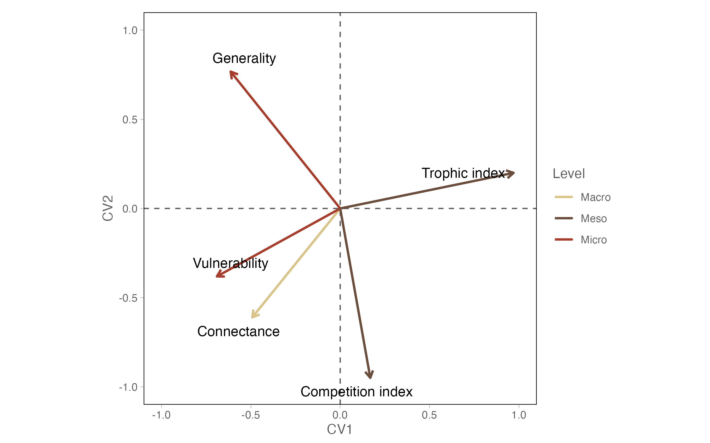
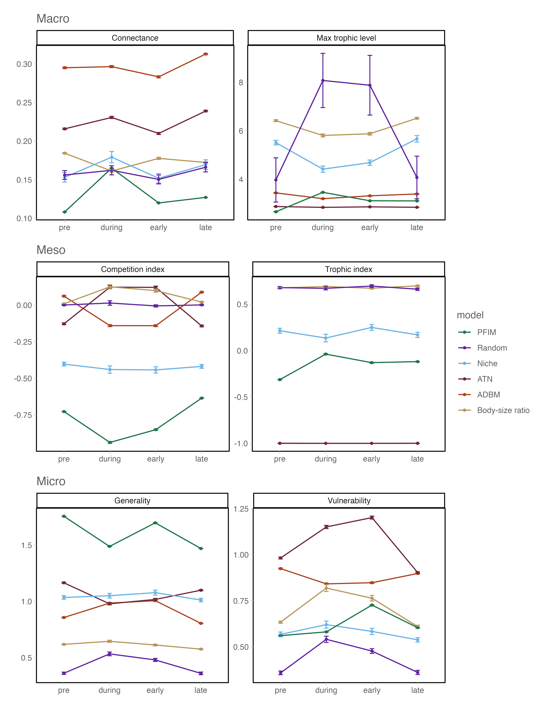
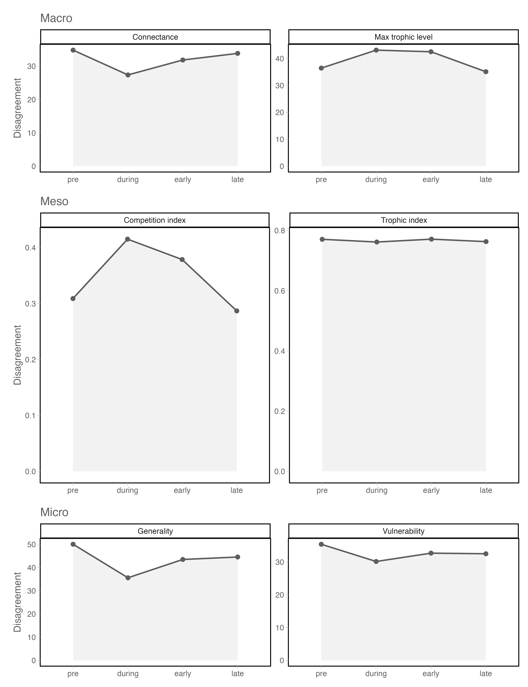
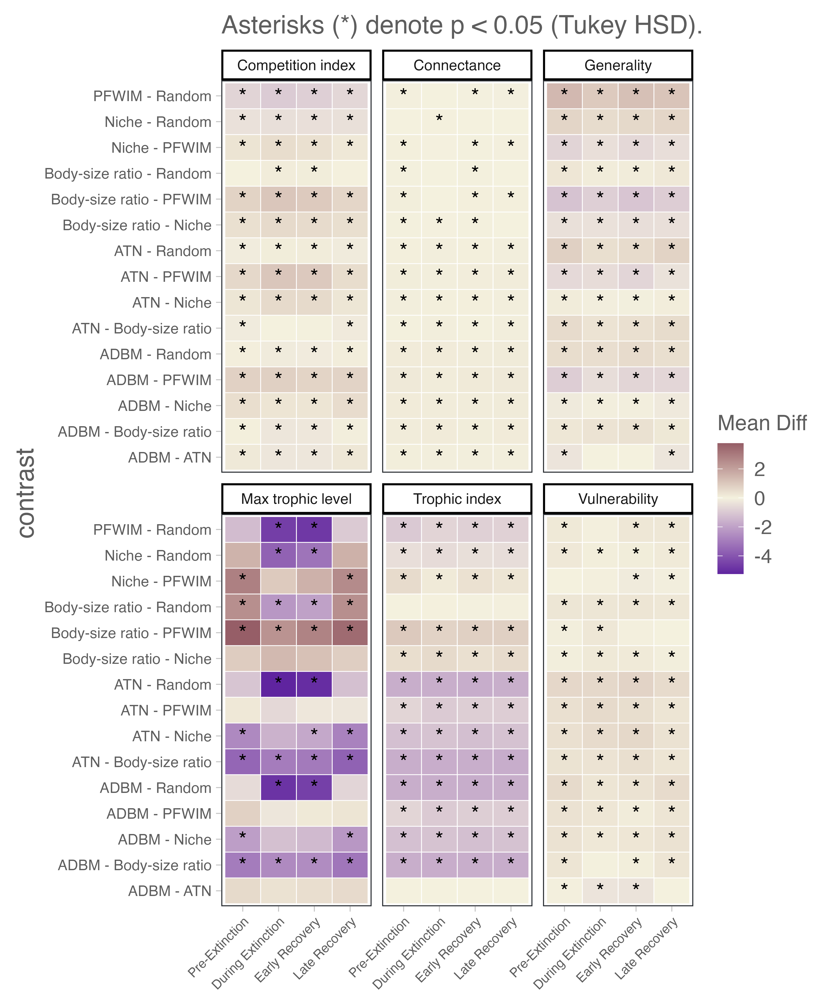
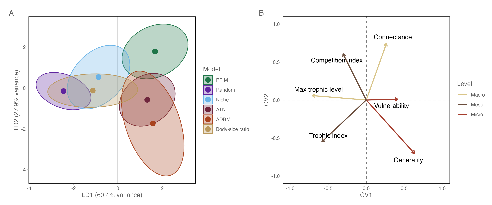
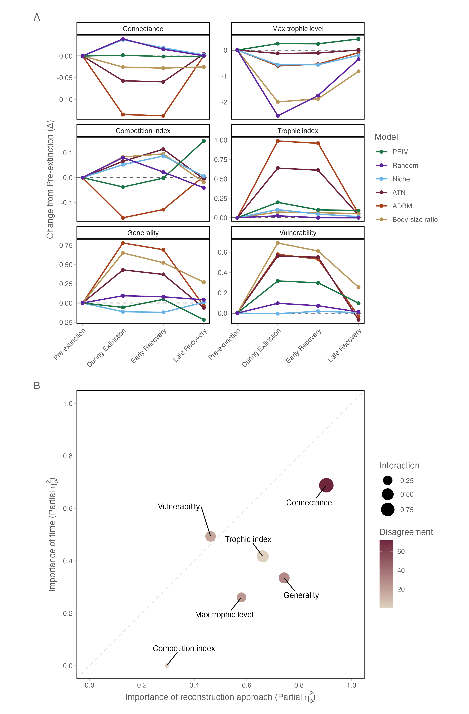

# Additional Results and Analyses

## Effects of network reconstruction on food web structure

### Table S1. Descriptive statistics (mean ± standard deviation) of network metrics by model

```{r}
library(knitr)
library(tidyverse)

readr::read_csv("tables/Table_S1_descriptive_stats.csv") %>%
kable()

```

### Table S2. Canonical discriminant analysis

```{r}

readr::read_csv("tables/canonical_loadings.csv") %>%
kable()

```

### Figure S1. Canonical Loadings

Canonical loadings for the first two canonical variates (CV1, CV2) from the canonical discriminant analysis of network metrics. Arrows indicate the contribution of each metric to the multivariate separation among reconstruction models. Colours denote the scale of each metric: Macro (light brown), Meso (brown), Micro (sienna). Metric labels are shown for the most influential variables.



### PERMANOVA Variance Partitioning

To quantify the relative contributions of model and temporal turnover to variation in inferred network structure, we conducted permutational multivariate analysis of variance (PERMANOVA). Euclidean distance matrices were calculated from standardised (z-transformed) network metrics. Model and extinction phase ('time') were analysed separately to estimate their total contributions to variance, and in combination to assess interaction effects. Significance was assessed using 999 permutations.

#### Robustness of model effects after temporal centering

To determine whether the dominance of model reflected absolute structural shifts among extinction phases, we repeated the analysis after centering network metrics within each time bin. This procedure removes mean temporal differences while preserving within-phase structural variation. Even after temporal centering, model type explained 84.8% of multivariate variance (R² = 0.848, p < 0.001), exceeding the variance explained in the uncentered analysis. Thus, the strong influence of model identity is not attributable to temporal mean differences, but reflects intrinsic structural divergence among models.

## Statistical Drivers of Network Variation

### Statistical Robustness and Assumptions

Factorial ANOVA assumptions were validated via residual analysis. Despite significant heteroscedasticity (Levene’s test, p<0.001), the perfectly balanced design (n = 100 per cell) and large sample size (N = 2400) ensure the robustness of the F-test. Visual inspection of Q-Q plots and Residuals-vs-Fitted plots confirmed that the distributions were sufficiently symmetric for parametric analysis.

### Figure S2. Temporal Trajectories of Network Structure by Model

Detailed shifts in network properties across the four extinction phases, categorised by organisational scale (Macro, Meso, Micro). Each line represents the mean value for a specific model, with error bars denoting standard error. This figure illustrates the "baseline" differences between models—such as the Niche model's tendency to over-estimate motif counts—and their divergent responses to species loss.



### Table S3. Variance Partitioning of Framework, Time, and Interaction Effects.

Summary of the two-way factorial ANOVA results for all eight metrics. Values represent partial eta-squared ($\eta^{2}_{p}$), which quantifies the proportion of variance explained by each factor. The dominance of the 'Model' term across all scales confirms that framework choice is the primary determinant of network topology.

```{r}

readr::read_csv("../tables/ANOVA_Results.csv") %>%
kable()

```

### Figure S3. Model Disagreement (CV%) Across Extinction Phases

Trends in inter-model disagreement, quantified as the Coefficient of Variation (CV%) between framework means. The Y-axis is standardised across panels to facilitate comparison between organisational scales. A characteristic "dip" at the 'during' phase in several meso-scale metrics illustrates the structural canalisation effect, where severe species loss forces a temporary convergence in model predictions.



### Table S4. Percentage Disagreement Between Frameworks Across Extinction Phases.

Calculated inter-model CV% for each metric at each time step. These data points underpin the bubble sizes in Figure 2 and the trajectories in Figure S3. Note the reduction in CV% for linear chains and omnivory motifs during the peak extinction phase (During).

```{r}

readr::read_csv("../tables/Model_Agreement_CV.csv") %>%
kable()

```

### Figure S4. Pairwise Framework Comparisons (Tukey HSD)

Heatmap showing significant differences between specific pairs of models across each extinction phase. Colours represent the magnitude and direction of the difference (estimate); asterisks ($*$) indicate statistical significance (p<0.05). This identifies which specific models drive the high CV values seen in Figure 2.



## Reconstruction approach choice influences inferred extinction dynamics

### Table S5. Kendall's Tau Correlation Coefficients

Kendalls Tau ($\tau$) values quantifying the amount of agreement between reconstruction approach as to the main driver of extinctions. This is determined based on the mean absolute difference rankings. Significant correlations (p<0.05) are denoted with an asterisk (*). The variability in $\tau$ values across models for the same metric highlights how reconstruction choice can lead to divergent interpretations of extinction drivers in network structure.

```{r}

readr::read_csv("tables/kendall_tau_coefficients.csv") %>%
kable()

```

## Constraining connectance decreases observed differences between models

It has been argued that connectance constrains emerging network properties [@poisot2014; @strydom2021]. To assess if constraining the connectance of *all* networks would result in similar network structures we actively constrained the connectance of all networks by randomly downsampling them to the target connectance *i.e.,* the PFIM, ATN, ADBM, and Body-size ratio models had links randomly prunes until they reached the target connectance. Note that in some instances the initial connectance of the network may have already been below the target connectance and in these instances the network was used 'as is'. We repeated both the multivariate and temporal trajectory analyses for these connectance constrained networks.

### Figure S5. Constraining connectance decreases observed differences in network structure

Although there is still a significant effect of model type on network structure (Pillai’s trace = 1.64, approximate $F_{30,10080}$ = 164.5, $p<$ 0.001) we can see that the visual clustering is much less dramatic than for the unconstrained networks (Figure 1 in the main text). However we do not see connectance as the *main* driver of differences in network structure in the mulitvariate space -- note the connectance is more strongly correlated with LDA axis 2 than with LDA axis 1 indicating that although it 'reduces' the differences in network structure between models it is not the main driver in the observed differences.



### Figure S6. Connectance increases the signal of time

When we look at the temporal changes in network structure there is qualitatively more agreement with the changes in network structure over time than for the unconstrained networks (Figure 2A in the main text) *i.e.,* we often see most models indicating similar changes in structure over time, although the magnitude of these changes remain different. Note that here we made no assumptions as to the expected changes in connectance over the extinction time and so there is a 'random' connectance signal across time - thus we can assume that the signal of temporal changes in network structure here still retain some sort of time $\times$ model signal. Indeed when we look at the two-way factorial ANOVA (panel B) we can see that model type is still the dominant determinant of network structure, however we see a greater source of variance coming from time (notably for vulnerability time becomes the dominant driver of variance).



Overall these results suggest that the specification of network connectance will impact the resulting overall network structure, however we still get distinct model-specific signature. This result is two-fold. Firstly it showcases that for any model where connectance is one of the parameters in the model there is a greater risk of enforcing differences or similarities in network structure depending on how connectance is specified -- *e.g.,* in this instance any assumptions we make on expected change in connectance over time will drive at least in part any inferences we make about changes in network structure for both Niche and Random networks. Secondly, despite connectance-driven constraints we still see model-specific differences in structure which re-enforces that these models are still encoding fundamentally different processes that determine where links are present within the network.

# References {.unnumbered}

::: {#refs}
:::